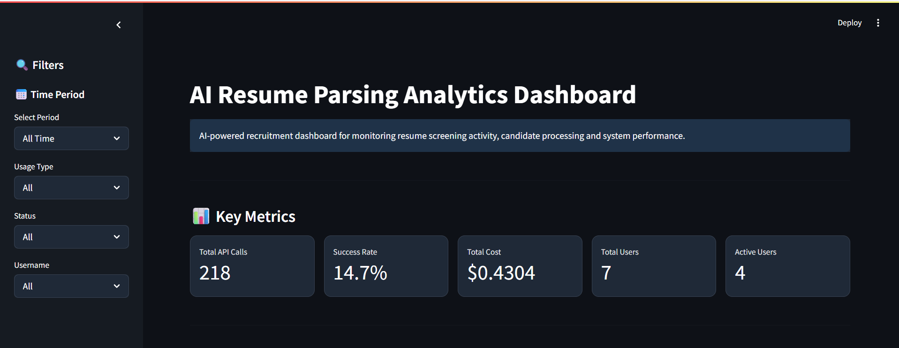
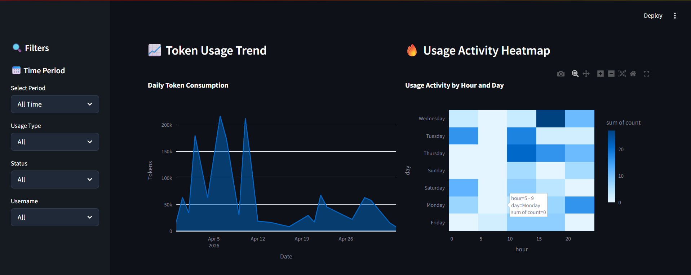
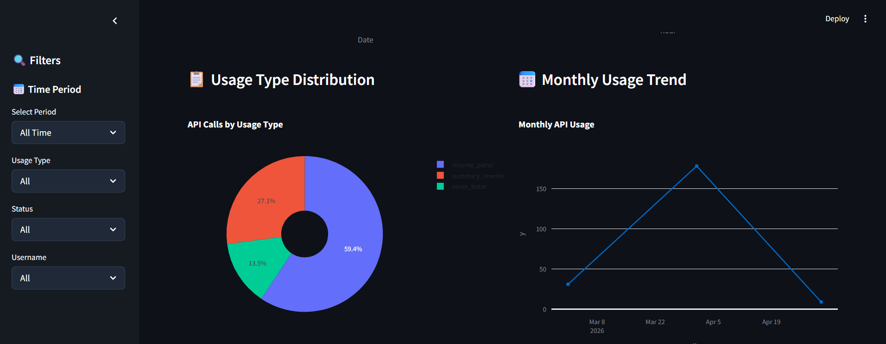
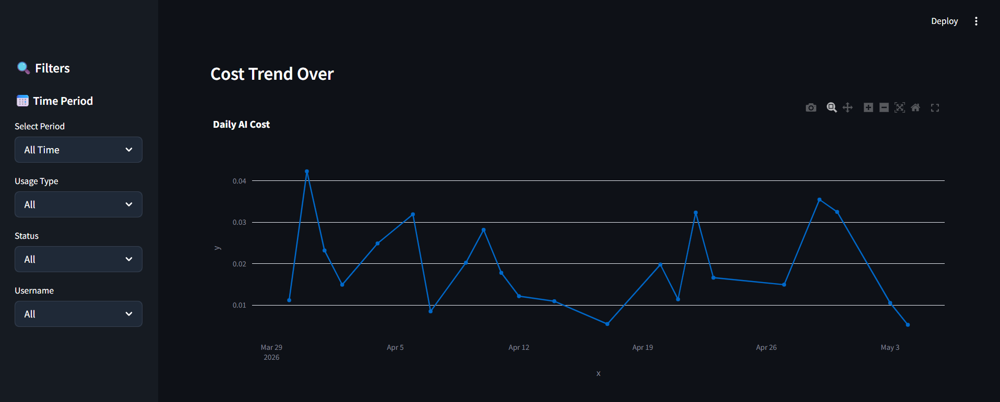
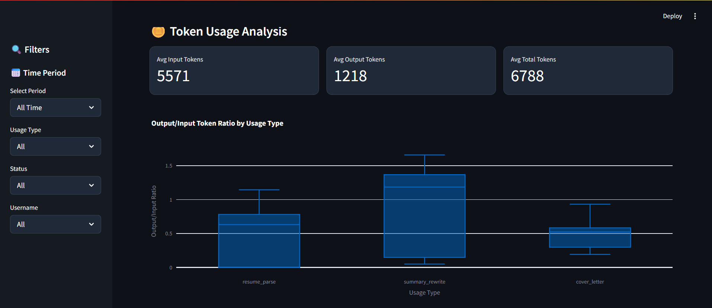
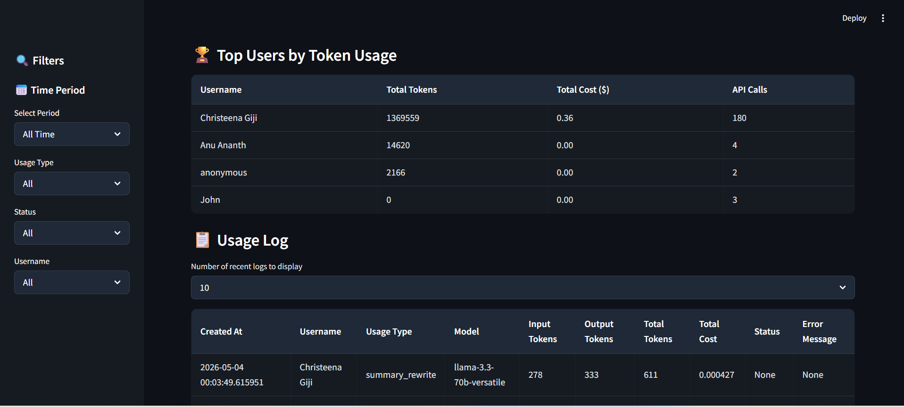

# AI Resume Parsing Analytics Dashboard

## Project Overview

An enhanced recruitment analytics dashboard developed during my internship at AINet.

The dashboard provides insights into recruitment and resume-parsing activities, helping monitor user activity, LLM token consumption and parsing errors.

## My Contribution

- Updated and refined existing KPI metrics.
- Modified existing charts and visualisations.
- Worked with data retrieved from Supabase.
- Updated application configuration and tested database connectivity.
- Improved dashboard reporting and presentation.

## Technologies Used

- Python
- Streamlit
- Pandas
- Plotly
- Supabase

## Dashboard Screenshots

### KPI Metrics

### KPI Charts

### Analytics and Visualisations

## Learning Outcomes

- Practical experience enhancing an existing Streamlit application.
- Experience working with database-connected analytics dashboards.
- Improved understanding of KPI reporting and data visualisation.
- Experience testing application connectivity and functionality.
